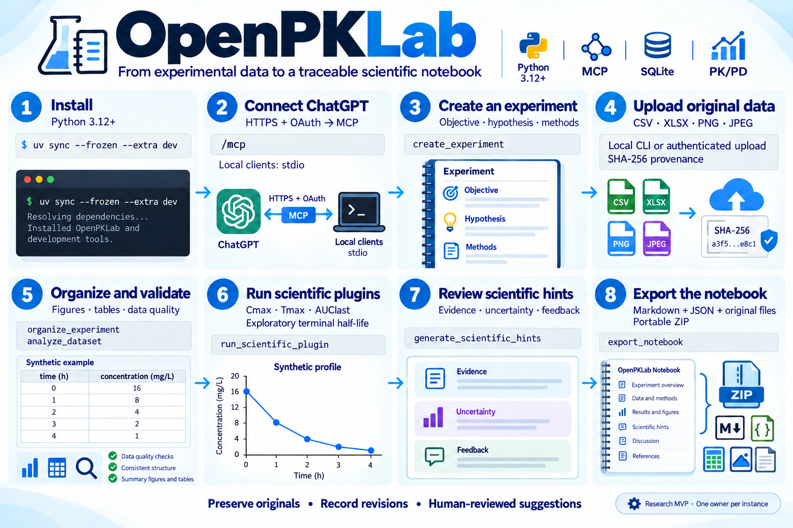

# OpenPKLab

An MIT-licensed, self-hosted scientific electronic laboratory notebook for in vitro, in vivo and PK/PD research. ChatGPT can be the primary interface through the official Model Context Protocol (MCP) Python SDK. Your SQLite database and original files remain on your infrastructure.

**v0.1.0 is a research MVP.** It supports one researcher/workspace per server instance. Computational screening and exploratory NCA are not clinical or regulatory validation. A ChatGPT connection requires a compatible reachable endpoint and configured OAuth; an actual ChatGPT session is a separate acceptance check.

## Visual workflow and quickstart

[](docs/QUICKSTART.md)

Open the [full-size graphic](docs/assets/openpklab-workflow.png) or follow the [eight-step illustrated guide](docs/QUICKSTART.md) for installation, ChatGPT connection, actual file upload, scientific analysis and notebook export. The graphic uses synthetic data from the bundled example.

After installing dependencies, run the complete local MCP workflow:

```bash
uv run --frozen python examples/mcp_workflow.py --data-dir .data
```

It creates a fresh synthetic experiment, checks the known NCA results, saves a derived figure and prints the exported ZIP path. It uses a real local MCP client; it does not claim an actual ChatGPT connection test.

## Install and start

Python 3.12+ and [uv](https://docs.astral.sh/uv/) are required for the locked development installation:

```bash
git clone https://github.com/fredsevmartins/OpenPKLab.git
cd OpenPKLab
uv sync --frozen --extra dev --python 3.12
uv run --frozen openpklab --data-dir .data serve
```

The default transport is **stdio**, intended for a local MCP client that launches the process. It does not expose a web endpoint. To run private HTTP for a compatible client:

```bash
export OPENPKLAB_TOKEN="$(python -c 'import secrets; print(secrets.token_urlsafe(48))')"
uv run --frozen openpklab --data-dir .data serve --transport http
```

HTTP always requires authentication for records, tools, upload and download. Only a data-free health check and OAuth discovery metadata are public. For Docker, HTTPS, persistence and backup instructions, see [Installation](docs/INSTALLATION.md).

## Connect ChatGPT

See [ChatGPT setup](docs/CHATGPT_SETUP.md). Use Streamable HTTP at `/mcp`, an HTTPS endpoint, and an OAuth 2.1 identity provider with PKCE S256 and compatible client registration. OpenPKLab verifies signed JWT access tokens and restricts access to the configured owner's subject. The private-client token above is **not** a ChatGPT OAuth integration.

No React application or UI widget is required. The tools return structured scientific records directly to the assistant. There is no OpenAI API key requirement or server-side LLM call.

## A complete notebook workflow

Ask the connected assistant:

1. “Create a pharmacokinetic experiment titled Synthetic PK; objective: validate an analytical example. Use experiment ID `synthetic-pk`.”
2. “Record that all data are synthetic. Add the synthetic protocol in the protocol methodology section.”
3. Upload the data using a supported workflow (below); provide the returned file ID to the assistant.
4. “Attach that file to `synthetic-pk`, title it Synthetic profile, and document time in h and concentration in mg/L.”
5. “Organize the tables and figures; identify missing methods without inventing details.”
6. “Run the `nca` plugin with `time_unit: h` and `concentration_unit: mg/L`; then plot with `pk_visualization` using the same units.”
7. “Show the scientific hints, explain their uncertainty, and record my feedback.”
8. “Generate the report and export the notebook.”

ChatGPT uploads are not automatically accessible to this server. On the notebook machine, a local owner can upload an actual file:

```bash
# Run this only if you have not already created the experiment through MCP.
uv run --frozen openpklab --data-dir .data create 'Synthetic PK' --id synthetic-pk
uv run --frozen openpklab --data-dir .data upload synthetic-pk examples/synthetic_pk.csv
uv run --frozen openpklab --data-dir .data export synthetic-pk synthetic-pk.zip
```

A researcher on another machine can use the authenticated HTTP upload endpoint; see the exact `curl` command in [Experiment workflow](docs/EXPERIMENT_WORKFLOW.md). Original CSV, XLSX, PNG and JPEG files are preserved with SHA-256 checksums. Reports include linked figures/tables and a JSON history in a portable ZIP. Download paths require authentication; they are not public share links.

## Scientific capabilities

- Flexible experiments, methods, conditions, observations, results, deviations, conclusions and explicit append-only revisions.
- Numbered figures and tables, source checksums, titles, captions, units and researcher-supplied associations.
- Data quality: missing values, duplicates, unit-column conflicts, invalid numeric entries, negative PK values and IQR outlier screening.
- Concentration-time plots on linear/log scales with group and individual profiles.
- NCA subset: Cmax, first Tmax, linear trapezoidal AUClast, and terminal lambda-z/half-life only when the documented exploratory checks pass.
- Event-triggered, deduplicated hints with evidence, computational finding, interpretation, hypothesis, action and uncertainty. Hints persist for the next interaction; no unsolicited ChatGPT notifications.
- Lightweight Python entry-point plugins. No bioequivalence, automatic statistical inference, PDF extraction, OCR, or fabricated scientific references.

See [Plugin methods](docs/SCIENTIFIC_PLUGINS.md), [Architecture](docs/ARCHITECTURE.md), [Test report](docs/TEST_REPORT.md), [Contributing](CONTRIBUTING.md) and [Security](SECURITY.md).

## Validate

```bash
uv run --frozen --extra dev pytest -q
uv build
```

All bundled examples and tests use synthetic data. Keep real research records, credentials and `.env` files out of Git.
